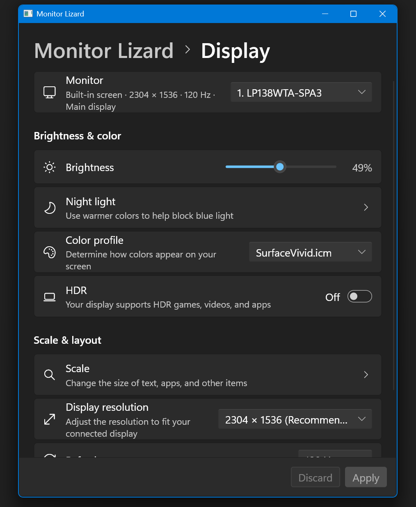

# 🦎 Monitor Lizard

Windows display settings, plus the stuff Windows forgot about.

Brightness and contrast on external monitors, input switching, refresh rate up front instead of buried in Advanced display. Open it, change things, close it. Nothing stays running.



## Does

- Brightness (laptop and external monitors)
- Contrast and input switching (external, over DDC/CI)
- Resolution, refresh rate, orientation
- HDR, color profile
- Extend / duplicate, main display
- Auto-reverts display changes after 15s unless you keep them

## Run

```
cargo run --bin monitor-lizard-ui    # window
cargo run -- help                    # command line
```

External monitor not responding? Turn on DDC/CI in the monitor's menu.

MIT · made with [Slint](https://slint.dev)
